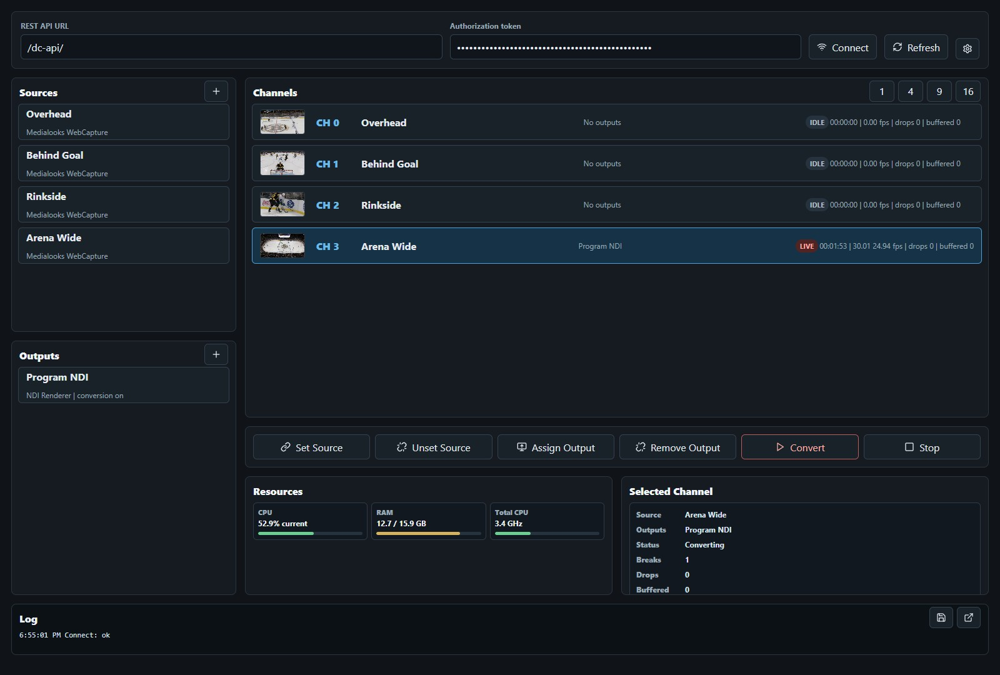

# Direct Convert Web Tools

This workspace contains a small browser dashboard and a local JavaScript client for the Medialooks Direct Convert REST API.



## Projects

- `directconvert-js-client` - dependency-free ESM client for the Direct Convert REST API.
- `directconvert-web-dashboard` - Vite-powered web dashboard that uses the local client package.

## Requirements

- Node.js 18 or newer
- npm
- A running Medialooks Direct Convert REST API service

By default, the dashboard proxies API requests from `/dc-api` to `http://127.0.0.1:9753/api`.

## Install

```sh
cd directconvert-js-client
npm install

cd ../directconvert-web-dashboard
npm install
```

## Run

```sh
cd directconvert-web-dashboard
npm run dev
```

Open the Vite URL shown in the terminal. In this workspace I used:

```text
http://127.0.0.1:9002
```

To point the proxy at a different Direct Convert REST host:

```sh
cd directconvert-web-dashboard
$env:DIRECTCONVERT_REST_TARGET = "http://127.0.0.1:9753"
npm run dev
```

The value should be the Direct Convert host root, not the `/api` path. The proxy rewrites `/dc-api` to `/api`.

## Features

- Connect to the Direct Convert REST API with an authorization token.
- View and manage channels, sources, output destinations, and devices.
- Assign sources and outputs to channels.
- Start and stop channel conversion.
- View resource metrics and channel conversion stats.
- Refresh channel previews on a configurable interval.
- Edit per-output conversion settings exposed by `api/app/conversion-lists`.

## REST API Documentation

GitBook-ready REST API documentation is available in `docs/`.

Start with:

```text
docs/README.md
```
